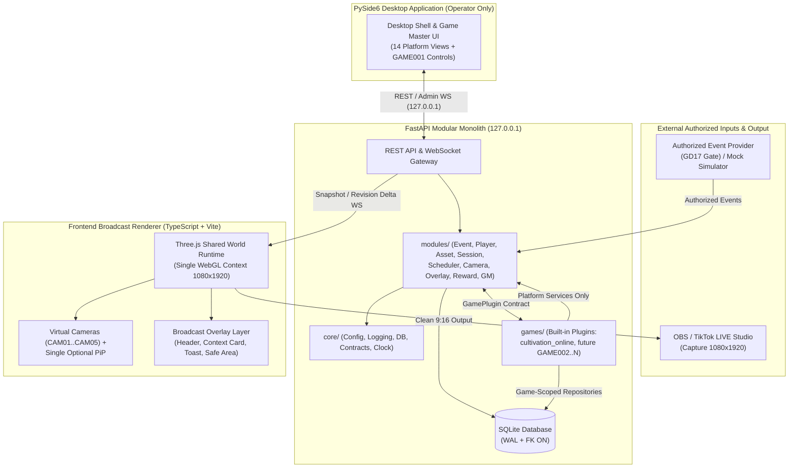
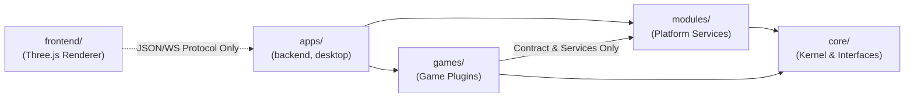

# SYSTEM ARCHITECTURE — LIVEGAME STUDIO

**Kiến trúc cốt lõi:** Local-First Modular Monolith + Game Plugin Architecture  
**Phiên bản:** 1.0.0 (GD00 Baseline)  

---

## 1. Tổng quan kiến trúc (High-Level Architecture)

### Standalone deployment boundary — ADR-021 (2026-11-26)

Toàn bộ topology dưới đây được nhân bản **độc lập** cho từng Windows PC/user: Desktop + loopback Backend + Renderer + local SQLite. Không máy nào là cloud server/authority cho máy khác; không shared game state, cloud player identity hay cross-device replication. Hybrid Cloud cũ **SUPERSEDED**; không có cloud dependency bắt buộc.

```text
PC A / Windows user A: Desktop → loopback Backend → DB A → local game/world A
PC B / Windows user B: Desktop → loopback Backend → DB B → local game/world B
                      Không kết nối DB A ↔ DB B
```

TikTok ID được map vào player trong local DB, rồi vào profile theo plugin/world. Cùng viewer không thừa hưởng progression của DB khác. Session/livestream mới trên cùng DB giữ nhân vật; đổi app/game version tương thích dùng migration, không reset. First run chỉ schema/default config/trusted metadata, không demo/test players. Quy trình GD02, không implementation GD01.

Installation chứa code/bundled resources readonly; `%LOCALAPPDATA%\LiveGameStudio` chứa dữ liệu writable của Windows user. Tách `database/`, `config/`, `assets/`, `cache/`, `logs/`; không ghi DB vào Program Files hoặc network/cloud-sync folder. Không dùng fingerprint để chọn DB, không auto import DB từ thiết bị khác. GD20 bundle Python + frontend build thay cho dev Python/Node/Vite dependencies; không bundle DB phát triển/.env/credentials. Local authenticated TikTok integration ở GD17 là nguồn event được cấp quyền, không biến thành cloud storage/auth platform.

Trusted local game management giữ ADR-010/Asset Contract; package ngoài chưa có loader MVP. Reset theo game là destructive operation cần confirmation + audit, không xóa game khác/settings ngoài phạm vi/production assets và không implement GD01. Benchmark GD19 nhiều máy/CPU/GPU, graphics presets/LOD/texture budget/visibility budget/capability detection và fallback; NVIDIA không bắt buộc.

LiveGame Studio chạy cục bộ trên máy Windows của người vận hành livestream, bao gồm 3 khối tiến trình/lớp phối hợp qua loopback (`127.0.0.1`):

1. **Backend Modular Monolith (Python + FastAPI + SQLite):** Nguồn sự thật duy nhất (Single Source of Truth) về cấu hình, plugin, simulation tick, sự kiện, người chơi, tài nguyên, sổ cái thưởng và lưu trữ.
2. **Desktop Control Application (PySide6):** Giao diện quản trị dành riêng cho Game Master (Dashboard, Game Library, Live Studio, Game Master Panel, Event Simulator, Asset Library, Settings). Giao tiếp với Backend qua REST API và WebSocket quản trị.
3. **Broadcast 3D/2D Renderer (TypeScript + Vite + Three.js, mở rộng Phaser.js):** Một màn hình WebGL dọc `1080×1920` duy nhất, nhúng qua `QWebEngineView` hoặc xuất cửa sổ/URL loopback cho OBS / TikTok LIVE Studio. Chỉ nhận state snapshot/delta từ Backend, tuyệt đối không chứa luật chơi.



---

## 2. Chiều phụ thuộc nghiêm ngặt (Dependency Direction Rules)

Để hỗ trợ mở rộng lên **100+ mini game** mà không phá vỡ cấu trúc, chiều phụ thuộc phải tuân theo quy tắc một chiều (Acyclic Layered Dependencies):



### Quy tắc cấm (Architectural Guardrails)
1. **`core/` không phụ thuộc bất kỳ lớp nào khác** (`modules/`, `games/`, `apps/`, `frontend/`).
2. **`modules/` chỉ được import `core/` và các `modules/` tầng thấp hơn theo DAG không vòng lặp.** `modules/` **tuyệt đối cấm import** bất kỳ mã nguồn nào từ `games/*`.
3. **`games/<plugin_a>/` tuyệt đối cấm import `games/<plugin_b>/`.** Mọi giao tiếp hoặc chia sẻ dữ liệu người chơi liên game đều đi qua `Player Manager` của Platform.
4. **`apps/desktop/` (PySide6) không truy cập trực tiếp SQLite hay import domain logic trong `games/`.** Mọi thao tác quản trị đi qua FastAPI REST/WebSocket để đảm bảo một nguồn sự thật và tránh khóa file SQLite từ nhiều tiến trình.
5. **`frontend/` (Three.js) không quyết định sát thương, XP, đột phá, cooldown hay phần thưởng.** Mọi tính toán luật chơi nằm 100% ở Backend.

---

## 3. Cấu trúc mã nguồn & Phân định ranh giới

| Thư mục | Vai trò | Ai sở hữu dữ liệu / logic |
|---|---|---|
| `apps/` | Entry points khởi chạy (`apps/backend`, `apps/desktop`), composition root kết nối dependency | Wiring & Lifecycle |
| `core/` | Kernel dùng chung: config schema, structured logger, DB session/UoW, monotonic clock, base exception, abstract contract interfaces | Platform Kernel |
| `modules/` | 37 năng lực nền tảng chia theo bounded modules (event, plugin, session, player, asset, camera, overlay, scheduler, reward, gm, live_studio, obs, analytics, tiktok_connector) | Platform Shared Domain |
| `games/` | Các Game Plugin độc lập (`games/cultivation_online/` cho GAME001, sau này `games/bar_online/`, ...). Mỗi plugin có `manifest.json`, domain thuần Python, application services, repositories riêng (`g_<plugin>_*`) | Game-Specific Domain |
| `frontend/` | Ứng dụng Vite + TypeScript + Three.js (và adapter Phaser.js tương lai): Scene Manager, Asset Loader, Character/Animation Controller, Camera Director Runtime, Overlay HUD 9:16 | Visual Presentation Only |
| `assets/` | Kho tài nguyên cục bộ đã kiểm chuẩn (`placeholders/`, `registry/`) theo Asset Contract | Validated Runtime Assets |
| `asset_production/` | Prompt templates, style guides, validation checklists sản xuất asset bên ngoài (`TT-AS`) | External Production Specs |
| `docs/` | Đặc tả, kiến trúc, hợp đồng, quyết định, roadmap và báo cáo nghiệm thu | Governance & Knowledge |
| `scripts/` | Script vận hành dev cục bộ (bootstrap venv, migrate, replay simulator, benchmark) | DevOps / QA Tooling |
| `tests/` | Kiểm thử tách lớp: `unit/`, `integration/`, `contracts/`, `replay/`, `ui/`, `frontend/`, `perf/` | Quality Assurance |

---

## 4. Kiến trúc đường ống sự kiện Livestream (Livestream Event Architecture)

Luồng xử lý chuẩn hóa từ đầu vào đến đầu ra hiển thị:

```text
Authorized Event Provider (hoặc Mock Event Simulator)
  → Event Gateway (schema validation, channel/session binding, auth boundary)
  → Normalized Event Envelope (UUID, source, source_event_id, schema_version)
  → Deduplication & Rate Limiter (idempotency store, per-player & burst protection)
  → Event Bus (bounded async queue với backpressure)
  → Command Parser (deterministic regex/alias table, không dùng LLM)
  → Active Game Plugin (cultivation_online hoặc plugin khác)
  → Gameplay Application Services (rule evaluation, cooldown, domain state)
  → SQLite Transaction (atomic UoW + reward_ledger + processed_events)
  → State Snapshot / Revision Delta Publisher (monotonic revision++)
  → Three.js Runtime (interpolation, animation, VFX, camera, overlay)
  → Broadcast Output 1080×1920 (OBS / TikTok LIVE Studio)
```

### Đặc tính chịu lỗi của đường ống
- **Chống xử lý trùng lặp:** Deduplicate hai tầng — tầng Event Gateway/Store theo `(source_namespace, source_event_id)` và tầng Reward/Action theo unique business key (`(event_id, player_id, reward_kind)`).
- **Thứ tự sự kiện (Ordering):** Bảo toàn thứ tự theo `(received_seq)` cho từng `player_id` và hàng chờ FIFO toàn cục (ví dụ hàng chờ Tiểu Thiên Kiếp) sử dụng cặp khóa `(received_at_monotonic, player_id)`.
- **Rate Limiting & Backpressure:** Hàng đợi nội bộ có dung lượng giới hạn (bounded queue). Khi chạm ngưỡng áp lực, ưu tiên giữ lệnh gameplay cốt lõi (`!join`, `!boss`, `!hothe`, `!dotpha`), gộp hoặc từ chối nhẹ lệnh hiển thị phụ (`!info`, `!find`, cosmetic bursts) thay vì treo bộ nhớ hay drop toàn bộ luồng.
- **Mất kết nối & Reconnect:** Khi provider mất kết nối, áp dụng grace period `15s` (cấu hình được); quá ngưỡng thì tạm đóng băng simulation clock và ngừng tích lũy XP/thưởng cho đến khi kết nối lại có kiểm soát.
- **Event Replay:** Mọi Normalized Event trong môi trường kiểm thử có thể ghi/phát lại (deterministic replay với injected clock) để tái hiện chính xác sự cố và xác minh idempotency.

---

## 5. Kiến trúc Thế giới chung & Đạo diễn Camera (Shared World & Camera Architecture)

### Nguyên tắc cốt lõi
- **Một thế giới chung, một WebGL renderer duy nhất:** Tuyệt đối **không tạo một WebGL context hay màn hình riêng cho từng người chơi**. Tất cả khán giả cùng xem một luồng `1080×1920` (9:16).
- **Phân tách Simulation State và Rendered State:**
  - *Simulation State (Backend):* Lưu toàn bộ người chơi đang hoạt động (ví dụ 100+ người chơi logic), vị trí zone/slot, HP, tu vi, trạng thái chiến đấu. Không bao giờ bị ảnh hưởng bởi việc nhân vật có đang nằm trong khung hình camera hay không.
  - *Rendered State (Frontend Three.js):* Chỉ hiển thị tập con trực quan cần thiết cho góc máy hiện tại, áp dụng nội suy vị trí/animation, LOD, frustum culling và giới hạn số lượng nameplate/VFX để bảo vệ mục tiêu FPS.

### Cơ chế Camera Director & Overlay
- **Multiple Virtual Cameras:** Định nghĩa tối thiểu 5 góc máy logic (`CAM01` Toàn cảnh, `CAM02` Tu luyện/Người mới, `CAM03` Độ kiếp, `CAM04` World Boss, `CAM05` Nhân vật nổi bật `!find`).
- **Camera Priority & Focus Queue:** Backend/Plugin phát ra `CameraIntent` với độ ưu tiên (`Boss 90 > Tribulation 80 > Breakthrough 50 > Personal !find 30 > Newcomer 20 > Idle 10`), thời gian giữ shot tối thiểu (`5s`), chuyển mượt (`0.6s`). Game Master có thể override thủ công và tự trả về auto sau `20s`.
- **Picture-in-Picture (PiP):** Tối đa **1 PiP** trong MVP (dùng cho góc máy phụ như Độ kiếp hoặc cận cảnh), render bằng secondary viewport/render-target trên **cùng một WebGLRenderer** (dùng `setScissor` / `setViewport`, không tạo WebGLRenderer thứ 2), có nút tắt nhanh để tiết kiệm GPU.
- **Crowd Rendering & Visibility Strategy:**
  - Tái sử dụng Geometry/Material, object pooling cho VFX và nameplates.
  - Áp dụng **Frustum Culling** và **3 mức LOD** (mục tiêu `5–8k / 2–3k / 0.5–1k` tris cho nhân vật, xác minh bằng benchmark ở GD19).
  - Lưu ý kỹ thuật quan trọng: **SkinnedMesh không dùng được `InstancedMesh` mặc định** cho animation độc lập từng nhân vật; chiến lược dự kiến là kết hợp giới hạn số nhân vật render chi tiết gần camera + chia nhóm animation / `BatchedMesh` hoặc LOD tĩnh cho nhân vật ở xa, và phải benchmark thực tế ở GD09/GD19.
  - Nameplates chỉ hiển thị cho nhân vật gần camera, nhân vật nổi bật hoặc theo yêu cầu `!find` để chống chồng chữ.

---

## 6. Ranh giới bảo mật (Security Boundaries — `HIGH-004`)

1. **Network Exposure & Origin Isolation:** FastAPI chỉ lắng nghe `127.0.0.1` theo mặc định, bật `TrustedHostMiddleware` (`127.0.0.1`, `localhost`) và restricted Origin policy (**cấm tuyệt đối wildcard CORS `*`**).
2. **Local Session Auth & Permission Separation:** Sinh khóa phiên ngẫu nhiên mật mã mỗi lần chạy (`ADMIN_SESSION_TOKEN` cho Desktop UI quản trị vs `RENDERER_STREAM_TOKEN` chỉ đọc cho màn hình phát sóng). `GET /api/v1/health` công khai cục bộ chỉ trả liveness tối thiểu; mọi privileged REST endpoint và `/ws/admin` bắt buộc xác thực Admin Token + Origin; `/ws/renderer` chỉ đọc và không thể thay đổi gameplay; tuyệt đối không đặt Admin Token vào Broadcast URL.
3. **Trusted Built-in Plugins Allowlist:** Giai đoạn đầu chỉ nạp plugin khớp chính xác **bảng allowlist tĩnh** trong Platform (không chỉ kiểm tra prefix module path), chặn nạp mã Python tùy ý bên ngoài (chống Arbitrary Code Execution).
4. **Path Traversal & File Exposure Protection:** Mọi đường dẫn trong Asset Manifest phải là relative path chuẩn hóa, bị chặn tuyệt đối nếu chứa `..`, ổ đĩa tuyệt đối (`C:\`, `D:\`), UNC path hay symlink thoát ra ngoài `assets/`; API không bao giờ expose đường dẫn đĩa tùy ý của máy chủ.
5. **Sanitization & Privacy:** Mọi tên hiển thị và nội dung từ viewer bị giới hạn độ dài (20 ký tự), escape HTML/XSS trước khi render lên Overlay, lọc từ khóa cấm và không truyền vào TTS nếu chưa kiểm duyệt.
6. **Secrets & Logging:** Không hardcode API key/token; mọi trường nhạy cảm bị tự động redact trong structured logs và `audit_logs`.

---

## 7. Khả năng mở rộng lên 100+ Mini Game (Scalability to 100 Games)

| Trục mở rộng | Thiết kế đảm bảo không gây nghẽn |
|---|---|
| **Đăng ký game mới** | Mỗi game là một package độc lập trong `games/<plugin_id>/` với `manifest.json` khai báo capabilities, assets, command schema, config schema. `Game Registry` khám phá qua registry allowlist thay vì `if/elif` rải rác trong `core/`. |
| **Cô lập dữ liệu** | Platform sở hữu bảng chung (`players`, `game_sessions`, `reward_ledger`, `assets`). Mỗi game chỉ sở hữu bảng prefix riêng (`g_<plugin_id>_*`) hoặc JSON config có schema version; tắt hoặc xóa 1 game không ảnh hưởng schema game khác. |
| **Cô lập giao diện Desktop** | Desktop Shell có khung điều hướng chuẩn (14 màn hình Platform) và khe mở rộng (Game Panel Extension Slot) để mỗi game chỉ khai báo widget/panel cấu hình riêng mà không sửa shell chính. |
| **Cô lập Renderer** | `frontend/` tách `PlatformRuntime` (WebSocket client, clock sync, asset loader, camera transitions, overlay HUD) khỏi `GameSceneAdapter` (scene riêng cho từng game 3D Three.js hoặc 2D Phaser.js trong tương lai). |
| **Cô lập Tài nguyên** | Mọi asset dùng ID ổn định có namespace (`TT_CHAR001`, `BAR_PROP001`, ...) và semantic version; nhiều game có thể tái sử dụng cùng asset chung (UI, audio, prop nền) thông qua `asset_dependencies`. |
