# DATABASE DESIGN — LIVEGAME STUDIO

**Hệ quản trị CSDL:** SQLite 3 (WAL mode, Foreign Keys ON)  
**ORM & Migration:** SQLAlchemy 2.x + Alembic (`render_as_batch=True`)  
**Phiên bản:** 1.0.0 (GD00 Baseline — chưa thực thi migration production trong GD00)

---

## 1. Nguyên tắc thiết kế & Cô lập dữ liệu (Data Ownership & Multi-Game Isolation)

1. **Một tệp SQLite cục bộ duy nhất, một tiến trình ghi duy nhất (`ADR-014`):** Chỉ FastAPI Backend mở kết nối ghi vào `data/livegame_studio.db`.
2. **Phân tách Schema theo Namespace (100+ Game Extensibility):**
   - **Platform Core Tables (14 bảng, không có tiền tố game):** Do `core/` và `modules/` sở hữu toàn quyền ghi. Mọi game chỉ đọc hoặc gọi qua Platform Services.
   - **Game-Specific Tables (`g_<plugin_id>_*`):** Mỗi mini game chỉ sở hữu bảng mang tiền tố định danh riêng (ví dụ `GAME001` dùng `g_cultivation_*`, `GAME002` tương lai dùng `g_bar_*`). Cấm game này truy vấn trực tiếp bảng `g_*` của game khác.
3. **Đối chiếu với `docs/games/cultivation_online/GDD.md` (v0.1.1) Mục 17 (`ADR-005`):**
   - Không tạo bảng trùng lặp `tt_sessions`, `tt_events`, `tt_reward_ledger`, `tt_processed_events`, `tt_action_audit`, `tt_worlds`. Các thực thể này được hợp nhất về bảng Platform chuẩn (`game_sessions`, `scheduled_events`, `reward_ledger`, `processed_events`, `audit_logs`) có gắn `plugin_id` / `world_scope`.
   - Các bảng nghiệp vụ riêng của Tu Tiên Online (`tt_profiles`, `tt_progress`, `tt_inventory`, `tt_participants`, `tt_tribulation_queue`) được chuẩn hóa thành 8 bảng `g_cultivation_*` liên kết chặt qua FK tới `player_game_profiles.id` và `game_sessions.id`.

---

## 2. Sơ đồ quan hệ thực thể (Entity-Relationship Diagram — ERD)

```mermaid
erDiagram
    application_settings {
        TEXT key PK
        TEXT value_json
        TEXT value_type
        INTEGER is_secret
        INTEGER version
        TEXT updated_at
        TEXT updated_by
    }

    game_plugins {
        TEXT plugin_id PK
        TEXT game_code UK
        TEXT name
        TEXT version
        TEXT engine_type
        TEXT status
        TEXT manifest_json
        TEXT installed_at
        TEXT updated_at
    }

    game_sessions {
        TEXT id PK
        TEXT plugin_id FK
        TEXT world_scope
        TEXT channel_id
        TEXT source_mode
        TEXT state
        TEXT control_mode
        INTEGER sim_elapsed_ms
        INTEGER last_revision
        TEXT config_snapshot_json
        TEXT started_at
        TEXT ended_at
        TEXT created_at
    }

    players {
        TEXT id PK
        TEXT display_name
        TEXT alias_name
        TEXT avatar_url
        INTEGER is_opted_out
        INTEGER is_anonymized
        TEXT created_at
        TEXT updated_at
        TEXT last_seen_at
    }

    external_identities {
        TEXT id PK
        TEXT player_id FK
        TEXT provider
        TEXT channel_id
        TEXT external_user_id
        TEXT raw_username
        TEXT first_seen_at
        TEXT last_seen_at
    }

    player_game_profiles {
        TEXT id PK
        TEXT player_id FK
        TEXT plugin_id FK
        TEXT world_scope
        TEXT status
        TEXT created_at
        TEXT last_active_at
    }

    assets {
        TEXT asset_id PK
        TEXT asset_type
        TEXT display_name
        TEXT active_version
        INTEGER is_placeholder
        TEXT created_at
        TEXT updated_at
    }

    asset_versions {
        TEXT id PK
        TEXT asset_id FK
        TEXT version
        TEXT manifest_json
        TEXT relative_root
        TEXT sha256_manifest
        TEXT license_name
        TEXT provenance_json
        TEXT validation_status
        TEXT validation_report_json
        TEXT created_at
    }

    asset_dependencies {
        TEXT id PK
        TEXT asset_version_id FK
        TEXT depends_on_asset_id FK
        TEXT version_constraint
        INTEGER is_required
    }

    event_ingestions {
        TEXT event_id PK
        TEXT session_id FK
        TEXT source
        TEXT source_event_id
        TEXT channel_id
        TEXT external_user_id
        TEXT event_type
        TEXT schema_version
        TEXT payload_json
        TEXT ingestion_status
        TEXT reject_reason
        TEXT occurred_at
        TEXT received_at
    }

    processed_events {
        TEXT id PK
        TEXT source_namespace
        TEXT source_event_id
        TEXT event_id FK
        TEXT session_id FK
        TEXT outcome
        TEXT processed_at
    }

    scheduled_events {
        TEXT id PK
        TEXT session_id FK
        TEXT plugin_id FK
        TEXT event_kind
        TEXT state
        INTEGER scheduled_sim_ms
        INTEGER priority
        TEXT config_snapshot_json
        TEXT started_at
        TEXT ended_at
        TEXT created_at
    }

    reward_ledger {
        TEXT id PK
        TEXT session_id FK
        TEXT plugin_id FK
        TEXT event_id
        TEXT player_id FK
        TEXT reward_kind
        INTEGER amount
        TEXT metadata_json
        TEXT created_at
    }

    audit_logs {
        TEXT id PK
        TEXT session_id FK
        TEXT actor
        TEXT action
        TEXT target_type
        TEXT target_id
        TEXT outcome
        TEXT detail_json
        TEXT created_at
    }

    g_cultivation_characters {
        TEXT profile_id PK
        TEXT appearance_code
        TEXT profession_code
        INTEGER auto_guard_enabled
        INTEGER selection_window_end_sim_ms
        TEXT runtime_state
        TEXT current_zone_id
        INTEGER slot_index
        TEXT created_at
        TEXT updated_at
    }

    g_cultivation_progress {
        TEXT profile_id PK
        INTEGER realm_tier
        INTEGER stage_index
        INTEGER xp
        INTEGER xp_reserved
        INTEGER spirit_stones
        INTEGER version
        TEXT updated_at
    }

    g_cultivation_realm_history {
        TEXT id PK
        TEXT profile_id FK
        TEXT session_id FK
        INTEGER from_realm
        INTEGER from_stage
        INTEGER to_realm
        INTEGER to_stage
        TEXT trigger_type
        INTEGER xp_spent
        TEXT created_at
    }

    g_cultivation_inventory {
        TEXT id PK
        TEXT profile_id FK
        TEXT item_id
        INTEGER quantity
        TEXT updated_at
    }

    g_cultivation_boss_events {
        TEXT id PK
        TEXT session_id FK
        TEXT scheduled_event_id FK
        TEXT boss_code
        TEXT state
        INTEGER participant_count
        INTEGER max_hp
        INTEGER current_hp
        INTEGER boss_def
        INTEGER started_sim_ms
        INTEGER deadline_sim_ms
        TEXT outcome
        INTEGER outcome_committed
        TEXT outcome_snapshot_json
        TEXT config_snapshot_json
        TEXT created_at
        TEXT ended_at
    }

    g_cultivation_boss_participants {
        TEXT id PK
        TEXT boss_event_id FK
        TEXT profile_id FK
        TEXT profession_snapshot
        INTEGER max_hp_snapshot
        INTEGER current_hp
        INTEGER atk_snapshot
        INTEGER def_snapshot
        INTEGER total_damage
        INTEGER total_healing
        INTEGER damage_mitigated
        TEXT status
        TEXT joined_at
    }

    g_cultivation_tribulation_queue {
        TEXT id PK
        TEXT session_id FK
        TEXT profile_id FK
        INTEGER target_realm
        INTEGER reserved_xp
        INTEGER queue_sim_ms
        TEXT status
        TEXT created_at
        TEXT updated_at
    }

    g_cultivation_tribulation_results {
        TEXT id PK
        TEXT queue_request_id FK
        TEXT session_id FK
        TEXT profile_id FK
        INTEGER target_realm
        INTEGER strikes_survived
        INTEGER final_hp_scaled
        TEXT outcome
        INTEGER xp_consumed
        INTEGER xp_refunded
        TEXT created_at
    }

    game_plugins ||--o{ game_sessions : runs
    game_plugins ||--o{ player_game_profiles : scopes
    players ||--o{ external_identities : linked_to
    players ||--o{ player_game_profiles : has_profile
    players ||--o{ reward_ledger : receives
    assets ||--o{ asset_versions : versions
    asset_versions ||--o{ asset_dependencies : requires
    assets ||--o{ asset_dependencies : referenced_by
    game_sessions ||--o{ event_ingestions : ingests
    event_ingestions ||--o| processed_events : deduplicated_by
    game_sessions ||--o{ scheduled_events : schedules
    game_sessions ||--o{ reward_ledger : issues
    game_sessions ||--o{ audit_logs : records
    player_game_profiles ||--|| g_cultivation_characters : extends
    player_game_profiles ||--|| g_cultivation_progress : tracks
    player_game_profiles ||--o{ g_cultivation_realm_history : logs
    player_game_profiles ||--o{ g_cultivation_inventory : owns
    game_sessions ||--o{ g_cultivation_boss_events : hosts
    scheduled_events ||--o| g_cultivation_boss_events : triggers
    g_cultivation_boss_events ||--o{ g_cultivation_boss_participants : includes
    player_game_profiles ||--o{ g_cultivation_boss_participants : joins
    game_sessions ||--o{ g_cultivation_tribulation_queue : queues
    player_game_profiles ||--o{ g_cultivation_tribulation_queue : requests
    g_cultivation_tribulation_queue ||--o| g_cultivation_tribulation_results : resolves_to
```

---

## 3. Chi tiết Schema Bảng Platform (14 bảng)

*(Mọi khóa chính dạng `TEXT` sử dụng UUIDv4/ULID; mọi mốc thời gian lưu chuỗi chuẩn UTC ISO-8601 `YYYY-MM-DDTHH:MM:SS.fffZ`.)*

| # | Bảng | Primary Key | Foreign Keys | Unique Constraints | Indexes quan trọng | Quyền sở hữu |
|---|---|---|---|---|---|---|
| 1 | `application_settings` | `key` | — | `PK(key)` | `idx_settings_updated_at(updated_at)` | Configuration Manager |
| 2 | `game_plugins` | `plugin_id` | — | `UK(game_code)` | `idx_plugins_status(status)` | Game Registry |
| 3 | `game_sessions` | `id` | `plugin_id → game_plugins(plugin_id)` | — | `idx_sessions_state(state)`, `idx_sessions_plugin_world(plugin_id, world_scope)` | Game Session Manager |
| 4 | `players` | `id` | — | — | `idx_players_last_seen(last_seen_at)` | Player Manager |
| 5 | `external_identities` | `id` | `player_id → players(id)` | `UK(provider, channel_id, external_user_id)` | `idx_ext_id_player(player_id)` | Player Manager |
| 6 | `player_game_profiles` | `id` | `player_id → players(id)`, `plugin_id → game_plugins(plugin_id)` | `UK(player_id, plugin_id, world_scope)` | `idx_pgp_plugin_world(plugin_id, world_scope, status)` | Player Manager |
| 7 | `assets` | `asset_id` | — | `PK(asset_id)` | `idx_assets_type(asset_type)` | Asset Registry |
| 8 | `asset_versions` | `id` | `asset_id → assets(asset_id)` | `UK(asset_id, version)` | `idx_asset_ver_status(asset_id, validation_status)` | Asset Registry |
| 9 | `asset_dependencies` | `id` | `asset_version_id → asset_versions(id)`, `depends_on_asset_id → assets(asset_id)` | `UK(asset_version_id, depends_on_asset_id)` | `idx_asset_dep_target(depends_on_asset_id)` | Asset Registry |
| 10 | `event_ingestions` | `event_id` | `session_id → game_sessions(id)` | — | `idx_ingest_session_recv(session_id, received_at)`, `idx_ingest_src(source, source_event_id)` | Event Gateway |
| 11 | `processed_events` | `id` | `event_id → event_ingestions(event_id)`, `session_id → game_sessions(id)` | `UK(source_namespace, source_event_id)` *(partial/nullable-safe)* | `idx_proc_session(session_id, processed_at)` | Event Gateway |
| 12 | `scheduled_events` | `id` | `session_id → game_sessions(id)`, `plugin_id → game_plugins(plugin_id)` | — | `idx_sched_due(session_id, state, scheduled_sim_ms)` | Event Scheduler |
| 13 | `reward_ledger` | `id` | `session_id → game_sessions(id)`, `plugin_id → game_plugins(plugin_id)`, `player_id → players(id)` | `UK(event_id, player_id, reward_kind)` | `idx_reward_player(player_id, plugin_id, created_at)` | Reward Ledger |
| 14 | `audit_logs` | `id` | `session_id → game_sessions(id)` *(nullable)* | — | `idx_audit_time(created_at)`, `idx_audit_actor(actor, action)` | Game Master |

### Ràng buộc CHECK cốt lõi trên bảng Platform
- `reward_ledger`: `CHECK (amount >= 0)`
- `game_sessions`: `CHECK (state IN ('CREATED','RUNNING','PAUSED','PAUSED_ERROR','STOPPING','COMPLETED','INTERRUPTED_RECOVERED'))`
- `asset_versions`: `CHECK (validation_status IN ('PENDING','VALID','INVALID','DEPRECATED'))`
- `event_ingestions`: `CHECK (ingestion_status IN ('ACCEPTED','DUPLICATE','REJECTED','RATE_LIMITED','REJECTED_BACKPRESSURE'))`
- `scheduled_events`: `CHECK (state IN ('SCHEDULED','ANNOUNCING','REGISTRATION','PREPARING','ACTIVE','RESOLVING','REWARDING','COMPLETED','CANCELED','CANCELED_RECOVERY','FAILED'))` *(thống nhất 100% tên trạng thái giữa ERD, TDD và Game Plugin Contract)*

---

## 4. Chi tiết Schema Bảng GAME001 — Tu Tiên Online (`g_cultivation_*`, 8 bảng)

| # | Bảng | Primary Key | Foreign Keys | Unique / Check Constraints | Indexes quan trọng | Mục đích |
|---|---|---|---|---|---|---|
| 1 | `g_cultivation_characters` | `profile_id` | `profile_id → player_game_profiles(id)` | `CHECK (appearance_code IN ('male','female'))`, `CHECK (profession_code IN ('sword','alchemy','body'))`, `CHECK (auto_guard_enabled IN (0,1))` *(default `1`)* | `idx_cult_char_state(runtime_state)` | Ngoại hình, nghề, tùy chọn hộ thể tự động (`!hotheauto on/off`), cửa sổ chọn 60s, trạng thái & vị trí zone |
| 2 | `g_cultivation_progress` | `profile_id` | `profile_id → player_game_profiles(id)` | `CHECK (realm_tier BETWEEN 0 AND 3)`, `CHECK (stage_index BETWEEN 0 AND 3)`, `CHECK (xp >= 0)`, `CHECK (xp_reserved >= 0)`, `CHECK (xp_reserved <= xp)`, `CHECK (spirit_stones >= 0)` | `idx_cult_leaderboard(realm_tier DESC, stage_index DESC, xp DESC, profile_id ASC)` | Cảnh giới, tầng, tu vi, XP đang giữ, linh thạch, `version` optimistic lock |
| 3 | `g_cultivation_realm_history` | `id` | `profile_id → player_game_profiles(id)`, `session_id → game_sessions(id)` | `CHECK (xp_spent >= 0)` | `idx_cult_realm_hist_prof(profile_id, created_at)` | Nhật ký lịch sử đột phá & độ kiếp thành công |
| 4 | `g_cultivation_inventory` | `id` | `profile_id → player_game_profiles(id)` | `UK(profile_id, item_id)`, `CHECK (quantity >= 0)` | `idx_cult_inv_prof(profile_id)` | Vật phẩm người chơi (MVP: `healing_pill` Hồi linh đan) |
| 5 | `g_cultivation_boss_events` | `id` | `session_id → game_sessions(id)`, `scheduled_event_id → scheduled_events(id)` | `CHECK (state IN ('SCHEDULED','ANNOUNCING','REGISTRATION','PREPARING','ACTIVE','RESOLVING','REWARDING','COMPLETED','CANCELED','CANCELED_RECOVERY','FAILED'))`, `CHECK (current_hp >= 0)` | `idx_cult_boss_sess(session_id, state)` | Phiên World Boss Bạch Lang Vương & config snapshot |
| 6 | `g_cultivation_boss_participants` | `id` | `boss_event_id → g_cultivation_boss_events(id)`, `profile_id → player_game_profiles(id)` | `UK(boss_event_id, profile_id)`, `CHECK (current_hp >= 0)`, `CHECK (total_damage >= 0)` | `idx_cult_boss_part_order(boss_event_id, profile_id ASC)` | Snapshot chỉ số, đóng góp sát thương/hồi máu/phòng thủ, trạng thái `ACTIVE/DEAD/FORFEITED` |
| 7 | `g_cultivation_tribulation_queue` | `id` | `session_id → game_sessions(id)`, `profile_id → player_game_profiles(id)` | `CHECK (reserved_xp > 0)`, `CHECK (status IN ('QUEUED','PREPARING','ACTIVE','SUCCEEDED','FAILED','CANCELED','CANCELED_RECOVERY'))` + Partial Unique Index cho trạng thái đang chờ/chạy trên `profile_id` | `idx_cult_trib_fifo(status, queue_sim_ms ASC, profile_id ASC)` | Hàng chờ FIFO Tiểu Thiên Kiếp tối đa 20, chống giữ XP hai lần |
| 8 | `g_cultivation_tribulation_results` | `id` | `queue_request_id → g_cultivation_tribulation_queue(id)` (`UK`), `session_id → game_sessions(id)`, `profile_id → player_game_profiles(id)` | `UK(queue_request_id)`, `CHECK (final_hp_scaled BETWEEN 0 AND 1000)` | `idx_cult_trib_res_prof(profile_id, created_at)` | Kết quả chi tiết từng lần độ kiếp, số lôi sống sót, XP tiêu/hoàn |

---

## 5. Đối chiếu bảng GDD Mục 17 sang Schema chính thức

| Bảng đề xuất trong GDD v0.1.0 | Bảng chính thức trong Platform/GAME001 | Ghi chú đối chiếu |
|---|---|---|
| `tt_worlds` | `game_sessions.world_scope` + `application_settings` | Scope world/channel được quản lý đồng nhất ở tầng Platform |
| `tt_sessions` | `game_sessions` (`plugin_id='cultivation_online'`) | Không tạo trùng bảng session |
| `tt_profiles` | `players` + `external_identities` + `player_game_profiles` + `g_cultivation_characters` | Tách định danh toàn cục khỏi nhân vật riêng từng game |
| `tt_progress` | `g_cultivation_progress` + `g_cultivation_realm_history` | Bổ sung lịch sử cảnh giới để kiểm chứng và phân tích |
| `tt_inventory` | `g_cultivation_inventory` | Giữ nguyên `UK(profile_id, item_id)` và `quantity >= 0` |
| `tt_events` | `scheduled_events` + `g_cultivation_boss_events` | Lịch chung ở Platform; dữ liệu chiến đấu Boss ở bảng riêng GAME001 |
| `tt_participants` | `g_cultivation_boss_participants` | Lưu đủ snapshot chỉ số, damage, healing, damage_mitigated |
| `tt_tribulation_queue` | `g_cultivation_tribulation_queue` + `g_cultivation_tribulation_results` | Tách hàng chờ và bản ghi kết quả bất biến |
| `tt_reward_ledger` | `reward_ledger` | Dùng chung cho mọi game với `UK(event_id, player_id, reward_kind)` |
| `tt_processed_events` | `event_ingestions` + `processed_events` | Tách bản ghi ingestion và khóa dedupe |
| `tt_action_audit` | `audit_logs` | Hợp nhất toàn bộ audit thao tác GM trên Platform |

---

## 6. Chiến lược Migration, Transaction, Idempotency & Crash Recovery

### 6.1 Migration Strategy (Alembic)
- Sử dụng Alembic với `render_as_batch=True` bắt buộc để hỗ trợ `ALTER TABLE` an toàn trên SQLite.
- Nhánh revision rõ ràng:
  - Migration nền tảng (`0001_platform_core`, `0002_assets_and_events`, ...) tạo 14 bảng Platform tại `GD02`–`GD07`.
  - Migration của từng plugin đặt tên có tiền tố plugin (`0010_g_cultivation_init`, ...) tại `GD11`–`GD15`.
- Tự động sao lưu tệp DB (`backups/pre_migrate_<timestamp>.db`) trước khi chạy `alembic upgrade head`.
- **GD00 tuyệt đối không thực thi migration production.**

### 6.2 Ranh giới Transaction & Database-Wide Single Writer (`HIGH-003`)
*(Thiết kế tại GD00; triển khai Centralized Write Coordinator tại GD02)*
- Mọi thao tác ghi vào SQLite đi qua **Centralized Write Coordinator** (bounded write queue / global write serializer đảm bảo **tối đa 1 write transaction hoạt động trên toàn bộ DB tại một thời điểm**, kèm `PRAGMA journal_mode=WAL`, `PRAGMA foreign_keys=ON`, `PRAGMA busy_timeout=5000`, `transaction_timeout_ms=5000`, rollback tự động khi lỗi/timeout và drain sạch + `wal_checkpoint(TRUNCATE)` khi shutdown). Khóa theo `player_id` không thay thế cho global write serialization của SQLite.

Mọi nghiệp vụ thay đổi trạng thái quan trọng chạy trong **1 SQLite transaction nguyên tử duy nhất**:
1. **Onboarding (`!join`):** Insert/Lookup `external_identities` → `players` → `player_game_profiles` → `g_cultivation_characters` (`auto_guard_enabled = 1`) → `g_cultivation_progress` → `g_cultivation_inventory` (`healing_pill = 3`).
2. **Normal Breakthrough:** Kiểm tra `xp - xp_reserved >= cost`, kiểm tra `version`, trừ `xp`, tăng `stage_index`, ghi `g_cultivation_realm_history`.
3. **Tribulation Reserve:** Kiểm tra chưa có yêu cầu active/queued (partial unique index), `xp - xp_reserved >= cost`, tăng `xp_reserved += cost`, insert `g_cultivation_tribulation_queue(status='QUEUED')`.
4. **Immutable Outcome Commit (`RESOLVING → REWARDING`):** Tính kết quả xác định, lưu `outcome`, `outcome_snapshot_json` bất biến, đặt `outcome_committed = 1` và chuyển trạng thái `REWARDING` trong **1 transaction nguyên tử** trước khi chạy phát thưởng.
5. **Reward Payout:** Insert `reward_ledger` (với `UK(event_id, player_id, reward_kind)`) + cập nhật `g_cultivation_progress` (`xp` có clamp cap `2 × cost`, `spirit_stones`) + `g_cultivation_inventory` (`healing_pill + 1`) trong **cùng transaction**. Nếu `reward_ledger` báo đã tồn tại → bỏ qua sạch không cộng lại.
6. **Consumable Use (`!heal`):** Kiểm tra `quantity >= 1`, trạng thái sống và chưa đầy HP → trừ `quantity -= 1` và hồi HP trong cùng transaction.

### 6.3 Idempotency & Plugin-Delegated Crash Recovery (`HIGH-005`)
- **Event Deduplication:** Khi `source_event_id` tồn tại, `processed_events` khóa duy nhất `(source_namespace, source_event_id)` ngăn xử lý lại khi reconnect hoặc replay. Nếu provider không cung cấp `source_event_id`, adapter phải khai báo rõ cơ chế và giới hạn, không tùy tiện gộp hai bình luận giống nhau thành một.
- **Crash Recovery (tách Platform Core vs Plugin Handler):**
  - Platform Recovery Core chỉ xử lý `game_sessions` (`RUNNING`/`PAUSED`/`PAUSED_ERROR`/`STOPPING` → `INTERRUPTED_RECOVERED`) và ủy thác cho từng plugin qua `plugin.recover_after_crash(uow, ctx)` (không hardcode logic hay bảng `g_cultivation_*` trong `core/` hay `modules/`).
  - *Ví dụ đối chiếu cho Plugin `cultivation_online`:*
    - Event/request chưa commit immutable outcome (`SCHEDULED`, `ANNOUNCING`, `REGISTRATION`, `PREPARING`, `ACTIVE`, `RESOLVING` với `outcome_committed = 0`) → chuyển `CANCELED_RECOVERY`, hoàn trả `100%` `xp_reserved` không phạt, không phát thưởng.
    - Event đã commit immutable outcome (`RESOLVING` với `outcome_committed = 1` hoặc `REWARDING`) → chạy bù idempotent qua `RewardLedger.grant_idempotent()` dựa trên `outcome_snapshot_json` rồi chuyển `COMPLETED`.
    - Trạng thái kết thúc (`COMPLETED`, `CANCELED`, `CANCELED_RECOVERY`, `FAILED`) → no-op.
- **Data Retention & Erasure:**
  - `event_ingestions` có chính sách dọn dẹp theo cấu hình (mặc định giữ 7 ngày, không lưu raw chat lâu hơn nhu cầu vận hành).
  - Xóa người chơi theo yêu cầu GM thực hiện ẩn danh hóa (`ADR-012`), bảo toàn toàn vẹn khóa ngoại của `reward_ledger` và `audit_logs`.
